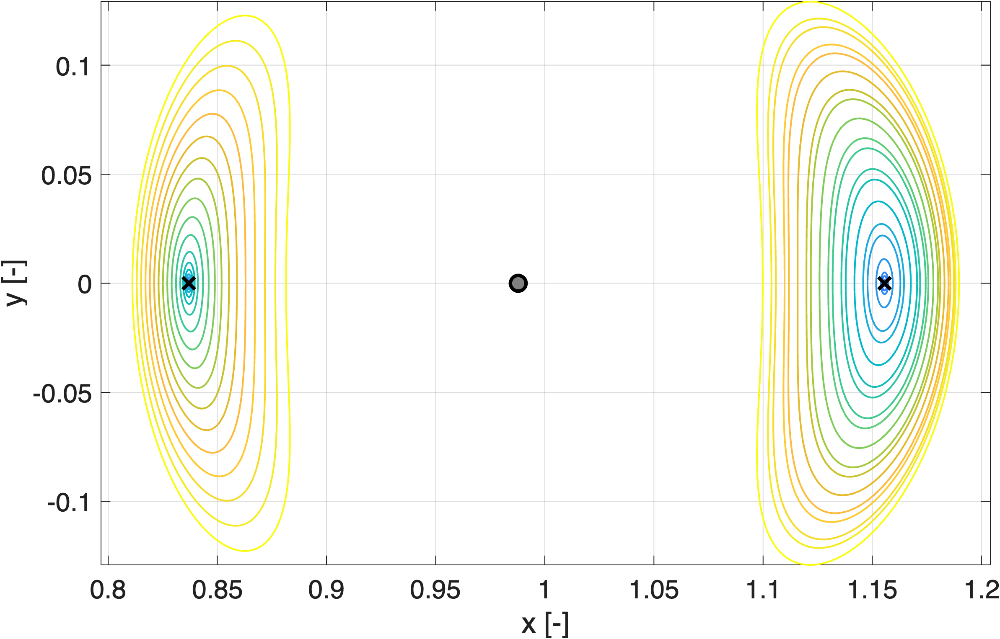
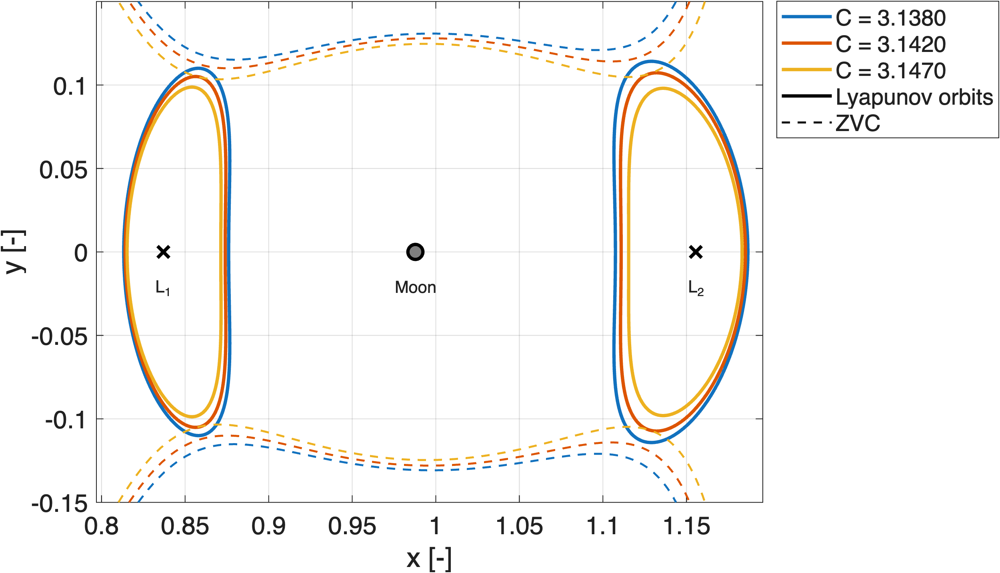
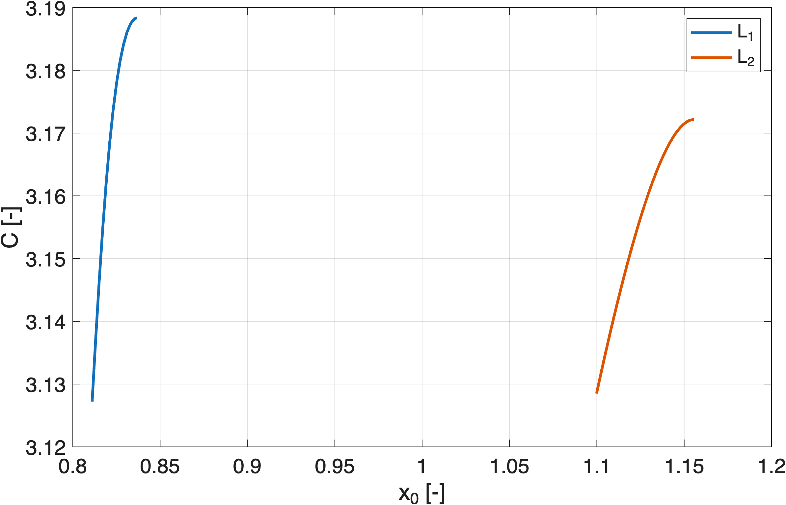
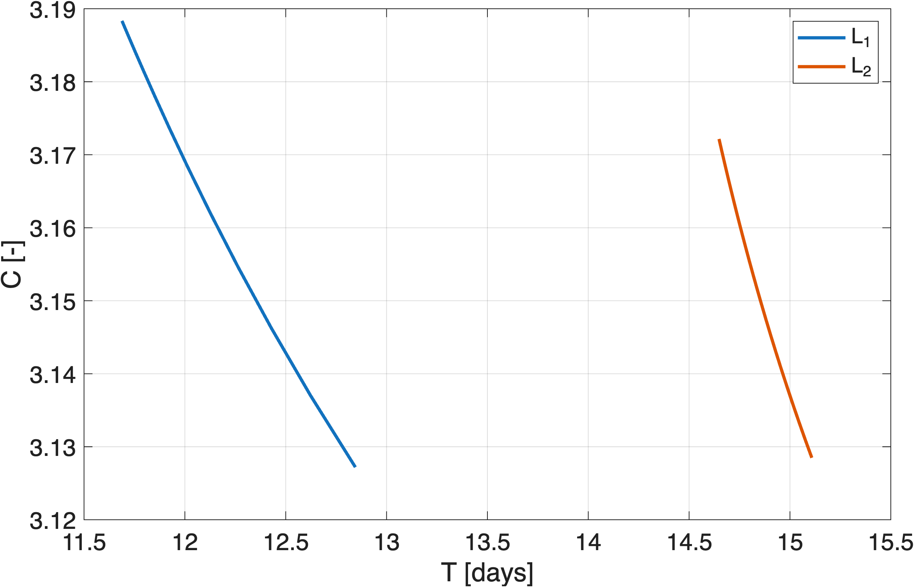

# Lyapunov Orbits in the Earth–Moon System (PCR3BP)

Computation of the **L₁ and L₂ Lyapunov orbit families** of the Earth–Moon system in the planar circular restricted three-body problem, and of **L₁/L₂ orbit pairs sharing the same Jacobi constant**. Implemented from scratch in MATLAB (single shooting, numerical continuation, bisection), with the full write-up in LaTeX.

Developed as coursework for *Interplanetary Trajectories*.



## The problem

Near the collinear libration points L₁, L₂ and L₃ the planar phase space has a *saddle × center* structure, which allows periodic motion (Lyapunov orbits) around an unstable equilibrium. These orbits are the starting point for studying natural transport between the Earth and Moon regions.

The task was to:

1. compute the full Lyapunov families of L₁ and L₂ starting from a small-amplitude orbit;
2. find L₁/L₂ orbit pairs with **identical Jacobi constant** in the range C ∈ [3.1370, 3.1493].

## Method

**Model.** In the synodic frame, with the Earth at −μ and the Moon at 1−μ, the Jacobi constant is

$$
C = 2U - (u^2+v^2), \qquad U = \frac{x^2+y^2}{2} + \frac{1-\mu}{r_1} + \frac{\mu}{r_2}
$$

**Initial guess.** The equilibrium is linearized, the eigenstructure of the Jacobian gives the center-subspace frequency ω and eigenvector, and the linear solution (amplitude 10⁻⁴) provides the first orbit guess.

**Correction by single shooting.** The dynamics are symmetric under (y, t) → (−y, −t), so two perpendicular crossings of the x-axis are enough for periodicity. With time rescaled as t = Tτ, the unknowns and constraints are

$$
X = [x_0,\ v_0,\ T]^T, \qquad F(X) = \begin{bmatrix} y(T/2) \\ u(T/2) \end{bmatrix} = 0
$$

and the Newton Jacobian is built analytically from the state transition matrix Φ, integrated together with the state (20 ODEs):

$$
DF = \begin{bmatrix} \phi_{yx} & \phi_{yv} & \frac{1}{2}\,\Phi(2,:)\,f(x_0) \\ \phi_{ux} & \phi_{uv} & \frac{1}{2}\,\Phi(3,:)\,f(x_0) \end{bmatrix}_{\tau=1/2}
$$

**Continuation.** Natural continuation on x₀ with an adaptive step (secant predictor, step halving on failure, growth ×1.5 up to a cap) and a consistency check on the period to avoid jumping to other orbit families.

**Equal-Jacobi pairs.** For each target C\*, a bisection on x₀ (re-running the shooting at every step) locates the orbit with C = C\* in each family.

**Numerics.** `ode113` with RelTol 3·10⁻¹⁴ and AbsTol 10⁻¹⁴; shooting tolerance 10⁻¹².

## Results

| | L₁ | L₂ |
|---|---|---|
| Orbits computed | 25 | 40 |
| Jacobi constant range | 3.1272 – 3.1883 | 3.1285 – 3.1722 |
| Period range | 11.7 – 12.9 days | 14.7 – 15.1 days |

Three L₁/L₂ pairs with equal Jacobi constant were obtained inside the required range:

| C\* | L₁ x₀ | L₁ period [d] | L₂ x₀ | L₂ period [d] | \|ΔC\| |
|---|---|---|---|---|---|
| 3.1380 | 0.8132887584 | 12.60 | 1.1074920475 | 14.99 | 4.9·10⁻¹² |
| 3.1420 | 0.8141442701 | 12.52 | 1.1109152322 | 14.94 | 1.1·10⁻¹¹ |
| 3.1470 | 0.8152591153 | 12.41 | 1.1154242732 | 14.89 | 4.1·10⁻¹² |

**Validation.** Over one full period every paired orbit closes to within **4.6·10⁻¹¹** (non-dimensional) and conserves the Jacobi constant to **≲ 2.2·10⁻¹⁵**. Tightening the shooting tolerance from 10⁻¹⁰ to 10⁻¹² reduced the closure error by one to three orders of magnitude, showing it is limited by the shooting residual, amplified by the orbit instability, and not by the integrator.

**Observations.**
- C decreases monotonically as the orbit grows, and the curves flatten near the libration point, as expected from the quadratic dependence of C_L − C on the amplitude.
- At equal C, the L₂ orbits are about 19–20% longer in period and displaced about twice as far from their libration point as the L₁ orbits.



<table>
  <tr>
    <td></td>
    <td></td>
  </tr>
</table>

## Repository contents

```
.
├── README.md
├── Homework1_InterTraj.pdf    # full report (theory, implementation, results)
├── Homework1_interpl.m        # MATLAB code
└── figures/                   # plots used in the report
```

## Author

**Francesco Caroletta** · [LinkedIn](https://www.linkedin.com/in/francesco-caroletta-a569852a6/) · [GitHub](https://github.com/FrancescoCaro) · [Email](mailto:francecaroletta@gmail.com)
